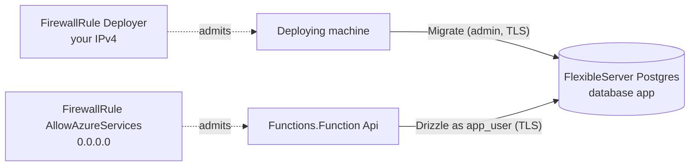

# Azure PostgreSQL with Drizzle

A todo API on Azure Functions (Flex Consumption, Node.js 22) backed by an
Azure Database for PostgreSQL flexible server, queried with Drizzle. The
deploy applies the Drizzle migrations from your machine and creates a
least-privilege role for the app.

| Method   | Path            | Body                                     |
| -------- | --------------- | ---------------------------------------- |
| `GET`    | `/todos`        | —                                        |
| `POST`   | `/todos`        | `{ "id": "<uuid>", "title": "Ship it" }` |
| `GET`    | `/todos/<uuid>` | —                                        |
| `PATCH`  | `/todos/<uuid>` | `{ "done": true }`                       |
| `DELETE` | `/todos/<uuid>` | —                                        |
| `GET`    | `/health`       | — (the app's database role, and TLS)     |

Invalid bodies and ids get `400`. A database error answers `500` with the
error tag.

## Architecture



- [`src/database.ts`](./src/database.ts)
  - `Alchemy.Random` `AdminPassword`: the administrator password, kept in
    state apart from the server. A deploy interrupted while the server is
    created still knows it, and the next deploy resets it on the server.
  - `Azure.PostgreSQL.FlexibleServer` `Postgres`: PostgreSQL 17, Burstable
    `Standard_B1ms`, 32 GiB, in `centralus`.
  - `Azure.PostgreSQL.FirewallRule` `AllowAzureServices`: the `0.0.0.0`
    rule. Flex Consumption apps have no fixed outbound addresses.
  - `Azure.PostgreSQL.Database` `App`: the `app` database.
  - `Alchemy.Random` `AppPassword`: the app role's password.
  - `Drizzle.Schema` `Schema`: regenerates `./migrations` with drizzle-kit
    when [`src/schema.ts`](./src/schema.ts) changes.
- [`src/migrate.ts`](./src/migrate.ts)
  - `Alchemy.Action` `DeployerAddress`: looks up your public IPv4 address
    (`https://api.ipify.org`, the service `az postgres flexible-server
    create` uses). It runs again when the schema changes.
  - `Azure.PostgreSQL.FirewallRule` `Deployer`: admits that address.
  - `Alchemy.Action` `Migrate`: connects as the administrator, applies
    pending migrations (recorded in `__alchemy_migrations`), and makes
    sure the `app_user` role exists with `SELECT`, `INSERT`, `UPDATE`,
    and `DELETE` on the tables. The role cannot create tables or read the
    migration history.
- [`src/Api.ts`](./src/Api.ts): `Azure.Functions.Function` in the Effect
  form. Its init reads the server's host name, the database name, and the
  role password as Outputs. Alchemy stores them as app settings, and the
  app reads them back at runtime. `Drizzle.Postgres` opens one TLS
  connection per request. The app depends on the `Migrate` output, so it
  deploys only after the schema exists.

Every resource lands in the stack's resource group (`<stack>-<stage>`).
Some subscriptions cannot create flexible servers in `eastus`
(`LocationIsOfferRestricted`), so the server is in `centralus` and the
app in the stack's default location.

## Cost

The server bills about $0.02 per hour (Burstable B1ms compute plus 32 GiB
storage) while it exists. Flex Consumption bills per execution and scales
to zero. One test run costs a few cents. Destroy the stack when you are
done.

## Deploy

Set up an Azure service principal and profile first: see
[Azure setup](https://alchemy.run/azure/setup). From the repository root:

```sh
pnpm install
cd examples/azure-postgres-drizzle
pnpm deploy --profile <name>
```

Creating the server takes 5-10 minutes. The stack prints the app's `url`.

```sh
curl -X POST "$URL/todos" -H 'content-type: application/json' \
  -d '{"id":"aaaaaaaa-0000-4000-8000-000000000001","title":"Ship it"}'
curl "$URL/todos"
```

## Changing the schema

Edit [`src/schema.ts`](./src/schema.ts) and deploy. `Drizzle.Schema`
writes a new migration under `./migrations` (commit it), `DeployerAddress`
and `Deployer` refresh the firewall rule, `Migrate` applies the migration
and grants the role access to new tables, and the app redeploys.

## Live test

```sh
ALCHEMY_PROFILE=<name> bun test
```

The test deploys the stack and checks the server, the database, and both
firewall rules through ARM. It connects as the administrator to check
that the migration ran and that `app_user` can write rows but cannot
create tables. It checks that the app signs in as `app_user` over TLS,
drives create, read, update, list, and delete over HTTP, and checks each
row directly in PostgreSQL. Then it destroys the stack and checks that the
server and the function app are gone. A run takes 10-20 minutes (about
10 minutes when measured).

## Destroy

```sh
pnpm destroy --profile <name>
```

Deletes the function app (with its plan and storage), the firewall rules,
the database, and the server (with its data).
