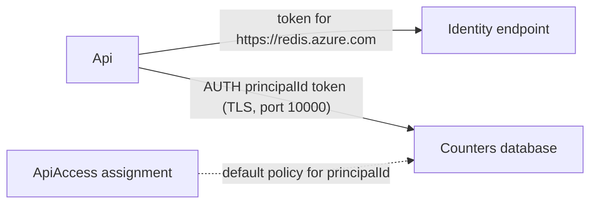

# Azure Managed Redis from an Azure Function

A fixed-window rate limiter on Azure Functions (Flex Consumption),
counting in Azure Managed Redis. Each key gets 5 hits per 60-second
window. After that the API answers `429` until the window resets.

| Route             | Returns                                                                     |
| ----------------- | --------------------------------------------------------------------------- |
| `POST /hit/:key`  | `200` (or `429` + `retry-after` once over the limit) with the counter below |
| `GET /count/:key` | the counter, without counting a hit                                         |

```json
{
  "key": "user-42",
  "count": 6,
  "limit": 5,
  "remaining": 0,
  "limited": true,
  "resetInSeconds": 41
}
```

A hit is one Redis round trip: `SET key 0 EX 60 NX` starts the window
(the TTL is only set when the key is new), `INCR` counts the hit and keeps
the TTL, and `TTL` reports the time left. When the key expires, the
window starts over.

## Architecture

- [`Cache`](./src/resources.ts) — `Azure.Redis.ManagedRedis`, the
  smallest SKU (`Balanced_B0`) with high availability off: one node, no
  replica, public endpoint, TLS 1.2.
- [`Counters`](./src/resources.ts) — `Azure.Redis.ManagedRedisDatabase`,
  the cluster's one database (`default`) on port 10000, TLS only, access
  keys off. `clusteringPolicy: "EnterpriseCluster"` puts one endpoint in
  front of every shard, so the client does not need to follow `MOVED`
  redirects.
- [`Api`](./src/Api.ts) — `Azure.Functions.Function` with a public URL.
- `ApiAccess` ([`alchemy.run.ts`](./alchemy.run.ts)) —
  `Azure.Redis.AccessPolicyAssignment` that gives the app's
  system-assigned managed identity the database's `default` access policy.

## Authentication

The app signs in to Redis with a Microsoft Entra ID token. No access key
or connection string reaches it.



[`src/EntraRedis.ts`](./src/EntraRedis.ts) does this per request:

1. It gets a token for `https://redis.azure.com/.default` from the
   Functions identity endpoint (`requestManagedIdentityToken` from
   `@distilled.cloud/azure`). `makeTokenCache` keeps the token until
   5 minutes before it expires.
2. It reads the identity's object ID from the token's `oid` claim. That
   is the app's `principalId`, the user name Redis expects.
3. It opens one TLS connection with `@alchemy.run/redis`, sends
   `AUTH <oid> <token>`, runs the commands, and closes the connection.

The database host name and port reach the app as app settings: the
Function reads `counters.hostName` and `counters.port` in its init, and
Alchemy carries the values to the deployed app.

The access policy assignment can take a minute to take effect after the
first deploy. Until then the API answers `503` with the Redis error.

## Cost

A `Balanced_B0` cluster without high availability costs about $0.02 per
hour. The Flex Consumption app is billed per execution. One test run
costs a few cents, so the test is not gated behind `AZURE_TEST_EXPENSIVE`.
Creating the cluster takes 5-10 minutes, and deleting it takes about as
long.

## Deploy

Set up an Azure service principal and profile first — see
[Azure setup](https://alchemy.run/azure/setup). From the repository root:

```sh
pnpm install
cd examples/azure-redis
pnpm deploy --profile <name>
```

```sh
curl -X POST "$URL/hit/user-42"
curl "$URL/count/user-42"
```

## Live test

```sh
ALCHEMY_PROFILE=<name> bun test test/integ.test.ts
```

The test deploys the stack. It reads the cluster, database, and access
policy assignment through ARM (Azure Resource Manager): `Balanced_B0`,
`Running`, `EnterpriseCluster`, access keys off, and the `default` policy
for the app's `principalId`. It waits until the app can sign in to Redis,
then hits a key until it is rate limited and checks the count, the window
TTL, and the `429`. Then it destroys the stack and checks that the
cluster and the function app are gone. Expect about 25 minutes, most of
it cluster create and delete.

## Destroy

```sh
pnpm destroy --profile <name>
```

Deletes the access policy assignment, the function app, the database, and
the cluster. `destroy` waits until the cluster is gone.
